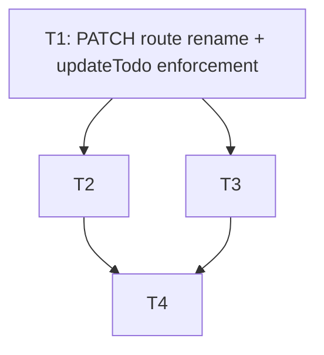

# Change ID: enforce-todo-ownership — Tasks

IMPLEMENT FIRST — first slice — one AC end-to-end, < 100 lines.

## T1 — Route parameter disambiguation + updateTodo enforcement (first slice)

- Input: `server/src/routers/boardRouter.js` line 18 (`router.patch("/:id/todo/:id", updateTodo)`); `server/src/services/todoServices.js` `updateTodo` (lines 40–54).
- Output: PATCH route becomes `router.patch("/:boardId/todo/:todoId", updateTodo)`; `updateTodo` reads `boardId`/`todoId` from `req.params` and `userId` from `req.user`; lookup filter becomes `{ _id: todoId, userId, boardId }`; on `null` returns `res.status(404).json({ message: "Todo not found" })`; preserves `name` handling (`$set: { name }`), `todo.save()`, re-fetch `Todo.findById({ _id: todoId })`, and `res.json(todo)` success payload. PUT and DELETE routes/handlers unchanged.
- Done: `PATCH /api/board/:boardId/todo/:todoId` with a valid owner JWT returns HTTP 200 with the existing todo payload; the same request with a non-owner JWT, wrong `boardId`, or missing `todoId` returns HTTP 404 `{ message: "Todo not found" }`; PUT and DELETE endpoints still function as before.

## T2 — checkTodo enforcement + PUT route rename

- Input: `server/src/routers/boardRouter.js` line 20 (`router.put("/:id/todo/:id", checkTodo)`); `server/src/services/todoServices.js` `checkTodo` (lines 56–95).
- Output: PUT route becomes `router.put("/:boardId/todo/:todoId", checkTodo)`; `checkTodo` reads `boardId`/`todoId` from `req.params` and `userId` from `req.user`; lookup filter becomes `{ _id: todoId, userId, boardId }`; on `null` returns `res.status(404).json({ message: "Todo not found" })`; preserves `action` switch including `default` (`created=true`, `inProgress=false`, `completed=false`), `todo.save()`, re-fetch, and `res.json(todo)` success payload.
- Done: `PUT /api/board/:boardId/todo/:todoId` with a valid owner JWT returns HTTP 200 with the existing todo payload; non-owner/wrong-board/missing returns HTTP 404; default/unknown `action` still sets `created=true`.

## T3 — deleteTodo enforcement + DELETE route rename

- Input: `server/src/routers/boardRouter.js` line 22 (`router.delete("/:id/todo/:id", deleteTodo)`); `server/src/services/todoServices.js` `deleteTodo` (lines 97–105).
- Output: DELETE route becomes `router.delete("/:boardId/todo/:todoId", deleteTodo)`; `deleteTodo` reads `boardId`/`todoId` from `req.params` and `userId` from `req.user`; lookup filter becomes `{ _id: todoId, userId, boardId }`; on `null` returns `res.status(404).json({ message: "Todo not found" })` instead of `res.json(null)`; preserves deleted-document `res.json(todo)` success payload.
- Done: `DELETE /api/board/:boardId/todo/:todoId` with a valid owner JWT returns HTTP 200 with the deleted todo document; non-owner/wrong-board/missing returns HTTP 404 `{ message: "Todo not found" }`.

## T4 — Verification (manual/static; no test framework added)

- Input: implemented T1–T3; delta.md decisions; plan.md.
- Output: Verification checklist covering: owner JWT → HTTP 200 with existing payload for PATCH/PUT/DELETE; non-owner JWT → HTTP 404; wrong `boardId` → HTTP 404; missing `todoId` → HTTP 404; `checkTodo` default/unknown `action` still sets `created=true`; `updateTodo` with absent/undefined `name` still proceeds. Explicit recorded decision: no new npm dependencies or server test framework introduced; verification is manual/static (e.g., curl against a local instance), not automated tests that were run.
- Done: Checklist completed and recorded; confirmed no new dependencies/test framework; no claim that automated server tests exist or pass.

## Task seams

- T1 defines the `req.params.boardId` / `req.params.todoId` seam for the PATCH route (replacing the shadowed `req.params.id`) and the inline ownership-scoped lookup contract: filter `{ _id: todoId, userId: req.user.userId, boardId }`, return `Todo` or `null`; on `null` → `res.status(404).json({ message: "Todo not found" })`. T2 and T3 replicate the same contract for PUT and DELETE.
- T2 depends on T1 only for the route-rename pattern (same `:boardId`/`:todoId` param names); T2 and T3 are otherwise independent of each other.
- T4 verifies all three handlers through the shared `req.params.boardId`/`req.params.todoId` seam and the 404 contract against real route handlers.

## Highest-risk task

T1 — it is the first end-to-end slice and must preserve `updateTodo`'s write-then-re-fetch success payload exactly while introducing the parameter rename and ownership filter; any inconsistency in the re-fetched document fields or the new filter breaks the preserved-behavior guarantee.

## Dependency/order

- T1: no predecessor (first slice; the app remains functional because PUT/DELETE routes/handlers are untouched).
- T2: can start after T1 (same route-rename pattern; independent of T3).
- T3: can start after T1 (independent of T2).
- T4: after T1, T2, and T3.

